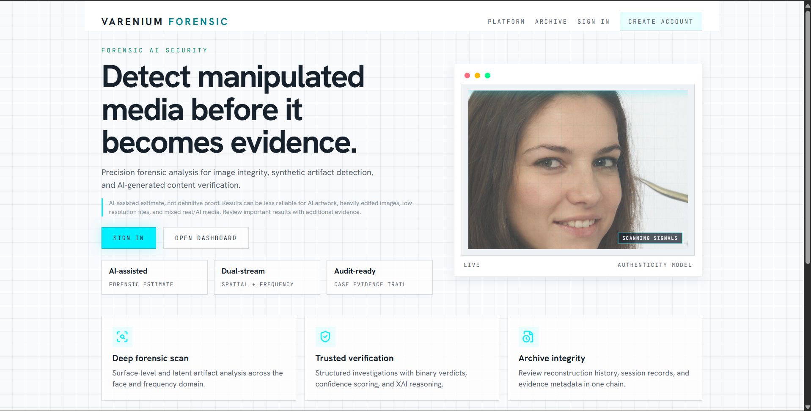
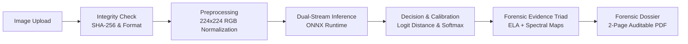
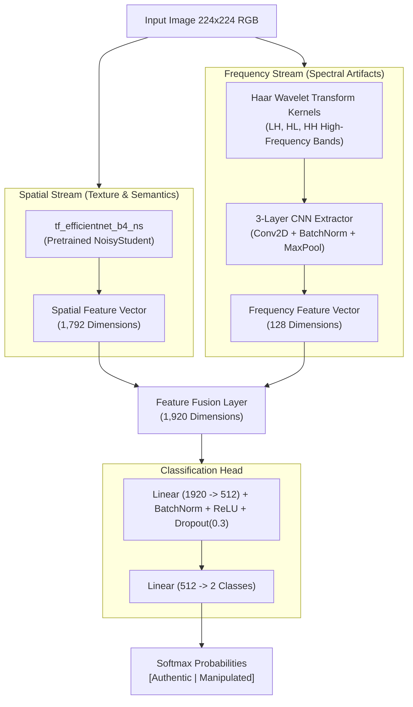

<div align="center">

# Varenium

### Deepfake Detection & Forensic Analysis

**Detect suspicious images. Understand the evidence. Document the investigation.**

[](https://www.python.org/)
[](https://flask.palletsprojects.com/)
[](https://onnxruntime.ai/)
[](https://pytorch.org/)
[](./README.md#contributing-and-license)

<br/>

<p align="center">
  Varenium is an end-to-end deepfake detection and digital forensics platform designed for media verification, security triage, and investigation. Unlike black-box classifiers that output an opaque probability, Varenium combines a dual-stream neural architecture with explainable AI (XAI) and cryptographically referenced chain of custody reports.
</p>

<br/>



</div>

---

### Table of Contents
- [Key Features](#-key-features)
- [How It Works](#-how-it-works)
  - [Investigation Pipeline](#investigation-pipeline)
  - [Dual-Stream Model Architecture](#dual-stream-model-architecture)
- [Why Varenium Is Different: Chain of Custody](#-why-varenium-is-different-chain-of-custody)
- [Technology Stack](#-technology-stack)
- [Quick Start](#-quick-start)
  - [Prerequisites](#prerequisites)
  - [Installation & Local Run](#installation--local-run)
  - [Docker Run](#docker-run)
- [Project Structure](#-project-structure)
- [Limitations & Responsible Use](#-limitations--responsible-use)
- [Contributing and License](#-contributing-and-license)

---

## ⚡ Key Features

| Capability | Description | Forensic Benefit |
| :--- | :--- | :--- |
| **Dual-Stream Detection** | Evaluates spatial artifacts (`EfficientNet-B4`) and spectral anomalies (`Haar DWT`) simultaneously. | Catches both photorealistic pixel-level blending defects and frequency-domain generation signatures. |
| **Explainable AI (XAI)** | Features PyTorch Grad-CAM explainability and real-time production Error Level Analysis (ELA) + local variance heatmaps. | Highlights exact facial regions contributing to detection rather than returning a raw score. |
| **Forensic Evidence Triad** | Correlates original input crops, spatial residual overlays, and FFT power spectrum distributions side by side. | Allows investigators to cross-verify visual, compression, and mathematical anomalies in one view. |
| **Chain of Custody PDF** | Generates a 2-page auditable PDF dossier with case IDs, timestamps, image SHA-256 hashes, and structured findings. | Provides an immutable snapshot of submitted evidence for reporting, case files, and peer review. |
| **Secure Lab Architecture** | Built with bcrypt password hashing, Firebase identity verification, rate limiting, and database audit logs. | Ensures investigation histories and user sessions remain compartmentalized and auditable. |

---

## 🔬 How It Works

### Investigation Pipeline

When an analyst submits an image, Varenium processes it through an integrity verification, feature extraction, and explainability workflow:



1. **Validation & Hashing**: The server verifies image integrity using PIL, enforces file size constraints, and computes a unique SHA-256 cryptographic digest of the raw bytes.
2. **Dual-Domain Evaluation**: The normalized crop passes through the dual-stream network running on ONNX Runtime for CPU/GPU inference.
3. **Evidence Synthesis**: Alongside the classification verdict (Authentic vs. Manipulated), Varenium extracts spatial residual anomalies (Error Level Analysis) and high-frequency spectral dispersion.
4. **Attribution & Export**: Findings are translated into human-readable signals and exported into a cryptographic forensic dossier.

---

### Dual-Stream Model Architecture

Generative models (GANs and diffusion pipelines) frequently leave subtle checkerboard artifacts and structural boundary anomalies that are difficult to isolate in spatial pixel space alone. Varenium addresses this with a two-pronged feature extractor:



* **Spatial Stream (`tf_efficientnet_b4_ns`)**: Extracts 1,792 semantic, boundary, and localized texture features using an EfficientNet-B4 backbone.
* **Frequency Stream (`Haar DWT`)**: Applies 2D Haar Wavelet decomposition kernels across high-frequency bands (LH, HL, HH), feeding them into a 3-block convolutional extractor to produce a 128-dimensional spectral vector.
* **Feature Fusion**: Spatial and frequency embeddings merge into a 1,920-dimensional representation and route through a dense classifier with batch normalization and dropout.

---

## 🛡️ Why Varenium Is Different: Chain of Custody

Standard deepfake detection tools display a percentage on screen, leaving no persistent record of what was analyzed or how findings were reached. Varenium treats deepfake detection as a forensic discipline where provenance and repeatability matter.

### What the Forensic Dossier Documents

Upon completing an analysis, Varenium compiles an auditable 2-page PDF report directly in the browser via `jsPDF`:

1. **Cryptographic Proof of Evidence**: The file's raw payload is hashed using **SHA-256** upon ingestion. If an image is modified or altered after analysis, its digest will not match the report.
2. **Case Metadata & Timestamps**: Every investigation receives a unique Case ID (e.g., `CASE-XXXXXX`), a UTC timestamp, and account attribution recorded in server-side audit logs.
3. **Visual Evidence Triad**: Renders the original subject crop alongside the spatial residual map (ELA / local variance) and the 2D Fourier/Laplacian frequency spectrum.
4. **Structured Decision Attribution**: Generates plain-English explanatory notes explaining why the classifier made its prediction, including logit separation distance and recommended review protocols.

> [!IMPORTANT]
> **Forensic Integrity Notice**: A cryptographic hash verifies that a specific file has not been altered since it was ingested; it does not verify where the file originated or prove real-world authenticity. Varenium reports are probabilistic triage tools intended to support human analysis, not self-authenticating legal judgments.

---

## 💻 Technology Stack

| Component | Technology | Role |
| :--- | :--- | :--- |
| **Inference Engine** | ONNX Runtime (`onnxruntime`) | Low-latency, optimized CPU/GPU model execution in production. |
| **Model Framework** | PyTorch & `timm` | Architecture definition (`EfficientNet-B4`, Haar DWT), training, and Grad-CAM. |
| **Computer Vision** | OpenCV (`cv2`) & Pillow (`PIL`) | Error Level Analysis, Haar filters, Laplacian transforms, and image preprocessing. |
| **Backend API** | Flask & Gunicorn | REST endpoints, authentication middleware, rate limiting, and audit logging. |
| **Database** | SQLite (Local) / PostgreSQL | Relational storage for users, investigation cases, file hashes, and security logs. |
| **Authentication** | Bcrypt & Firebase Admin SDK | Secure credential hashing and verified Google OAuth authentication. |
| **Frontend** | Vanilla HTML5, CSS3, ES6 JS | Lightweight, zero-framework reactive dashboard with dynamic visualizations. |
| **Report Engine** | jsPDF | Client-side cryptographic forensic PDF report rendering. |

---

## 🚀 Quick Start

### Prerequisites
* **Python 3.10+** (Python 3.11 or 3.12 recommended)
* **Git**

### Installation & Local Run

1. **Clone the repository:**
   ```bash
   git clone https://github.com/Yashraj552/Varenium-deepfake-detector.git
   cd Varenium-deepfake-detector
   ```

2. **Create and activate a virtual environment:**
   ```bash
   # Linux / macOS
   python3 -m venv .venv
   source .venv/bin/activate

   # Windows (Command Prompt / PowerShell)
   python -m venv .venv
   .venv\Scripts\activate
   ```

3. **Install backend dependencies:**
   ```bash
   pip install -r backend/requirements.txt
   ```
   *(Note: The production ONNX model weights `best_deepfake_detector.onnx` are included in the repository. No separate model download is required to run the application).*

4. **Start the application:**
   ```bash
   python backend/main.py
   ```
   *(Windows users can alternatively run `run_local.bat`).*

5. **Access the platform:**
   Open your browser and navigate to **`http://localhost:5001`**. Register a local account to access the investigation dashboard.

### Docker Run

To run the application inside a container:

```bash
docker build -t varenium .
docker run -p 8080:8080 varenium
```

Then visit **`http://localhost:8080`**.

---

## 📁 Project Structure

```text
├── backend/
│   ├── main.py                    # Flask API, security headers, ONNX inference & auth
│   ├── requirements.txt           # Production server dependencies
│   ├── auth.db / forensic.db      # SQLite investigation & audit storage (local fallback)
│   └── uploads/                   # Stored forensic investigation artifacts
├── model/
│   ├── best_deepfake_detector.onnx# Serialized dual-stream production model
│   ├── predict.py                 # CLI inference script with face-crop & Grad-CAM
│   ├── requirements.txt           # PyTorch & training dependencies
│   └── src/
│       ├── models/
│       │   ├── spatial_stream.py  # EfficientNet-B4 spatial feature extractor
│       │   ├── frequency_stream.py# 2D Haar Wavelet filter & CNN sub-network
│       │   └── fusion.py          # MultiStreamDetector concatenation & classification
│       ├── evaluation/explain.py  # PyTorch Grad-CAM explainability module
│       └── training/trainer.py    # Training loop with PEFT and AUC/F1 tracking
├── legacy_frontend/
│   ├── landing.html / landing.css # Public product landing page
│   ├── dashboard.html / style.css # Investigation workbench & evidence viewer
│   ├── history.html               # Case records and investigation logs
│   ├── app.js                     # UI interactivity & jsPDF forensic report generator
│   └── auth.js                    # Session handling and login flows
├── tests/
│   └── test_security.py           # Unit tests for rate limiting, auth & role guards
├── Dockerfile                     # Container deployment definition (Cloud Run / Railway)
└── run_local.bat                  # One-click Windows development launcher
```

---

## ⚠️ Limitations & Responsible Use

* **Probabilistic Assessment**: Varenium produces algorithmic assessments based on statistical patterns learned during training. Model confidence scores are probabilistic estimates and should never be taken as definitive proof of authenticity or manipulation.
* **Compression & Resolution**: Low-resolution images (under 224x224 px) or files with extreme multiple-generation JPEG recompression can degrade frequency-domain fidelity, potentially triggering false positives or reduced sensitivity.
* **XAI Heatmaps**: Heatmaps generated via Error Level Analysis and local variance highlight areas of high statistical difference; they do not identify intent, origin, or specific generative software.
* **Intended Use**: Varenium is developed to assist media researchers, journalists, and security practitioners in triaging suspicious content. All findings should be corroborated with independent provenance research and source verification.

---

## 🤝 Contributing and License

Contributions that improve detection robustness, expand frequency-domain extractors, or enhance forensic reporting are welcome. Please open an issue to discuss proposed changes prior to submitting a pull request.

**License**: All rights reserved. This repository and its contents are currently proprietary to the author. For licensing inquiries, permissions, or academic collaboration, please contact the repository maintainer through [GitHub Issues](https://github.com/Yashraj552/Varenium-deepfake-detector/issues).
